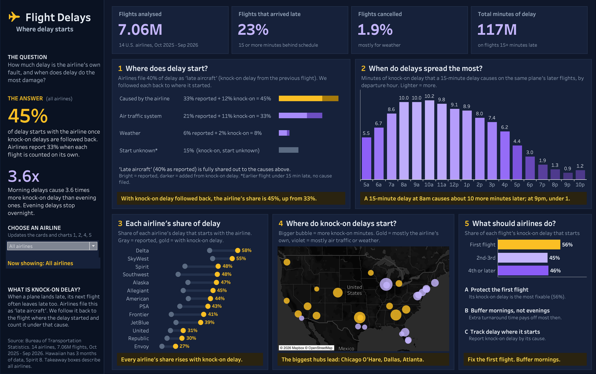

# Where Airline Delay Starts, and What an Airline Controls (2025–26)

**About 45% of delay starts with the airline once knock-on delays are followed back, and morning delays do the most damage.**

**Real, public data:** Bureau of Transportation Statistics (BTS) on-time records for every flight by the 14 reporting U.S. airlines, October 2025 to September 2026: 7.06 million flights.

📊 **[Open the live dashboard on Tableau Public](https://public.tableau.com/app/profile/nicolette.mtisi6362/viz/flight_dashboard_17957504935560/Dashboard)** · workbook file: [`tableau/flight_dashboard.twbx`](tableau/flight_dashboard.twbx)

[](https://public.tableau.com/app/profile/nicolette.mtisi6362/viz/flight_dashboard_17957504935560/Dashboard)

## The question

An airline's director of operations (an illustrative scenario) says: *"Our delays keep cascading through the day, and every report just says 'late aircraft'. How much of our delay is actually in our control, and where does it start?"*

| Flights analysed | Arrived 15+ min late | Delay that starts with the airline | Morning vs evening knock-on delay |
|:-:|:-:|:-:|:-:|
| **7.06M** | **23%** | **45%** (33% when each flight is counted on its own) | **3.6x** |

**Knock-on delay** is delay passed from one flight to the next on the same plane. Airlines file it as "late aircraft", which is accurate for that flight. This project follows each plane through its day to find the flight where the delay started.

📄 **[One-page brief](docs/brief.md)**

## What this shows

- **The airline's share rises from 33% to 45%.** Airlines file 40% of delay minutes as "late aircraft". Followed back, about 30% of it started with the airline, 28% with the air traffic system, 5% with weather, and 37% can't be followed (the earlier flight was under 15 minutes late, so no cause was filed). If that unknown part splits like the rest, the airline's share is about 52%; at most 59%.
- **This doesn't contradict the official figures.** They answer "what made this flight late?"; this answers "where did the delay begin?", using the same reported causes.
- **Morning delays spread, evening delays stop.** A 15-minute delay on an 8am departure causes about 10 more minutes on the plane's later flights; at 9pm, under 1. Evening flights pick up the most new delay, but planes stop overnight.
- **The first flight of the day is the most fixable.** 56% of the knock-on delay it causes starts with the airline, against 45% for later flights.
- **Every airline's share rises** once knock-on delay is followed back, from Envoy (27%) to Delta (58%).

### A prediction I got wrong

Before looking at the data I predicted that carrier delay was the biggest controllable cause (right, and larger than reported) and that delay chains start on evening flights at big hubs (mostly wrong: evening delay rarely spreads, and the biggest hubs spread delay roughly in line with their size).

## Recommendations

1. **Protect the first flight of the day** with a daily readiness target for crew, maintenance and boarding.
2. **Buffer mornings, not evenings:** add turnaround time to morning rotations first.
3. **Track delay where it starts:** report knock-on delay by its starting cause each month, with the unknown share shown.

## How I checked the numbers

- **Against BTS's published figures:** month by month, our on-time rate is within 0.35 points, cancellations within 0.17 points and delay-cause shares within 1.4 points. (BTS's page also counts codeshare partners, so our file holds 90–91% of its flights every month.)
- **Delay causes add up** to the arrival delay on all but 159 of 1.6 million late flights.
- **Following planes works:** the previous flight lands at the next flight's origin 98.3% of the time.
- **Every delay minute is accounted for** after following knock-on delay back (117.3M), and a forward and a backward pass agree exactly.

## Limits

- Causes are self-reported by airlines, and delays under 15 minutes have no recorded cause.
- Splitting knock-on delay in proportion to the earlier flight's causes is an assumption.
- Hawaiian reports only October to December 2025, and Spirit October 2025 to May 2026.
- Associations between hours or airports and delay don't prove why; sizing in the brief is an order of magnitude, not a forecast.

## How it's built

| Step | Notes | Code |
|---|---|---|
| Question | [Framing](docs/01-questions.md) | – |
| Data | [Profile](docs/02-data-profile.md) | `src/load.py`, `src/profile.py` |
| Method | [Following knock-on delay back](docs/03-tracing-method.md) | `src/trace.py` (SQL ordering in DuckDB, two passes in Python) |
| Analysis | [Findings](docs/04-analysis.md) | `src/analysis.py` |
| Validation | [Against BTS's published figures](docs/05-validation.md) | `src/validate.py`, `scripts/fetch_bts_published.py` |
| Recommendations | [Actions](docs/06-recommendations.md) | – |
| Dashboard | [`tableau/flight_dashboard.twbx`](tableau/flight_dashboard.twbx) | `src/tableau_data.py` |

**To run it** (about 350 MB of downloads):

```
python3 -m venv .venv && .venv/bin/pip install -r requirements.txt
./scripts/download_bts.sh
./run_all.sh
```

**Tools:** SQL (DuckDB), Python (pandas, NumPy), Tableau Public.

**Sources:** [BTS Reporting Carrier On-Time Performance](https://www.transtats.bts.gov/Tables.asp?QO_VQ=EFD) · [BTS Airline On-Time Statistics and Delay Causes](https://www.transtats.bts.gov/OT_Delay/OT_DelayCause1.asp) · [OurAirports](https://ourairports.com/data/) (airport locations, public domain).

**Author:** Nicolette Mtisi. Not affiliated with any airline or with BTS.
